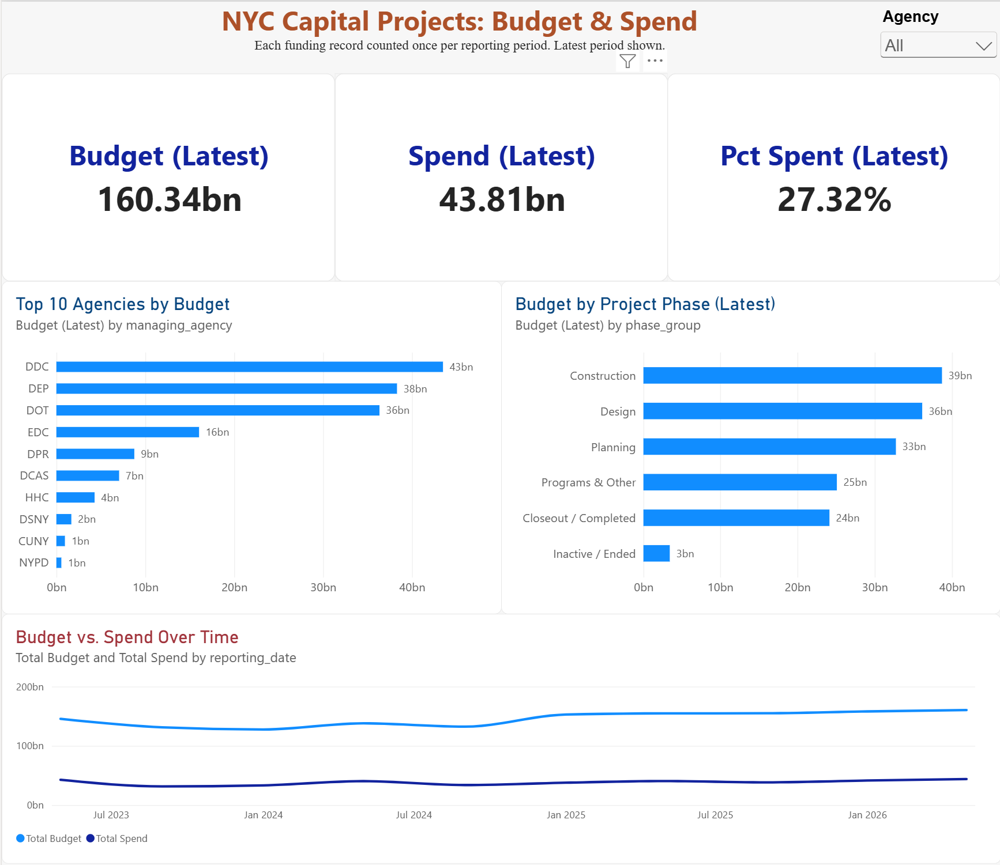
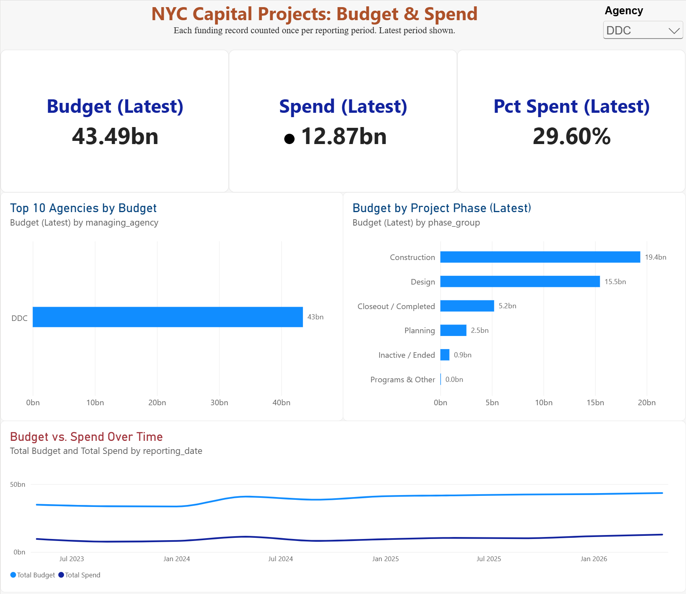

# NYC Capital Projects: Budget & Spend Pipeline

An end-to-end data pipeline and Power BI dashboard built on NYC Open Data's capital projects dataset. It pulls the raw data from an API, cleans and validates it in Python, loads it into SQL Server, and reports on it in Power BI.



## The problem

The dataset is a snapshot published every reporting period, so each project appears many times. Budget and spend figures also repeat across the project (`pid`) rows of a single funding record. Adding up the raw column therefore counts the same money more than once.

On the latest reporting period, a simple sum of the budget column comes to about $207.6B, roughly $47.3B (29%) more than the $160.34B you get when each funding record is counted once. This project handles that by counting each funding record once per reporting period.

## Data source

- NYC Open Data, Socrata API, dataset `fb86-vt7u`: [Capital Projects Dashboard - Citywide Budget and Schedule](https://data.cityofnewyork.us/d/fb86-vt7u)
- 56,525 rows x 27 columns across 10 reporting periods
- No API key needed. The extract script pages through the data with `$limit`, `$offset` and `$order`.

## Pipeline

| Step | File | What it does |
|------|------|--------------|
| 1. Extract | `src/extract.py` | Pulls all rows from the API in pages and saves the raw CSV |
| 2. Clean + validate | `src/clean.py` | Trims text, parses dates, fixes types, drops exact duplicates, and checks that the natural key is unique |
| 3. Load | `src/load.py` | Creates the database and table in SQL Server and bulk-loads the clean data |
| 4. Model | `sql/` | Views that count each funding record once, plus analysis queries |
| 5. Report | `dashboard/` | Power BI file built on the dashboard view |

The natural key is `fms_id + managing_agency + pid + reporting_period`. `clean.py` stops with an error if that key isn't unique, so bad data can't reach the database.

## How the double counting was handled

`sql/01_create_view.sql` creates `v_funding_records`. It keeps one row per `fms_id + managing_agency + reporting_period` using `ROW_NUMBER() OVER (PARTITION BY ...)`. The dashboard view `v_dashboard` is built on top of it, and the Power BI measures only sum that view.

`sql/02_double_count_check.sql` and `sql/08_validate_dashboard_total.sql` show the difference and confirm that the dashboard total matches SQL ($160,336,058,990.19).

## Dashboard

- **Cards:** latest total budget, spend, and percent spent
- **Top 10 agencies by budget**
- **Budget by project phase** (phase groups are my own grouping of the source's phase values)
- **Budget vs. spend over time** across the 10 reporting periods
- **Agency filter.** Selecting DDC gives about $43.5B budget, $12.9B spend and 29.6% spent, which matches the SQL results.



## Tech used

Python (pandas, requests, SQLAlchemy, pyodbc), SQL Server Express, SSMS, Power BI Desktop (DAX), Git/GitHub

## How to run

1. Install SQL Server Express and ODBC Driver 18. Python 3.12 is recommended.
2. Create and activate a virtual environment, then install the packages:
   ```
   pip install pandas requests sqlalchemy pyodbc
   ```
3. Run the pipeline from the project root:
   ```
   python src/extract.py
   python src/clean.py
   python src/load.py
   ```
4. In SSMS, run `sql/01_create_view.sql` and then `sql/07_create_dashboard_view.sql` on the `NYCCapitalProjects` database.
5. Open `dashboard/nyc_capital_projects.pbix` in Power BI Desktop and refresh. (TODO: use your actual .pbix filename.)

`src/load.py` assumes SQL Server at `localhost\SQLEXPRESS`. Change `SERVER` at the top of the file if yours is different.

## Assumptions and limitations

- Phase groups (Planning, Design, Construction and so on) are my own grouping of the source phase values.
- Some records show spend above budget. This may mean the budget was not updated, so I kept them as published instead of correcting them.
- Large budget changes between periods may be re-baselining, not real changes in funding.
- If two agencies have records with the same `fms_id`, they count as separate funding records.
- The columns `actual_construction` and `actual_construction_1` were left out of the load because their meaning is unclear.

## About

Built by Iftiak Ahmed as a portfolio project for data analytics and automation roles.